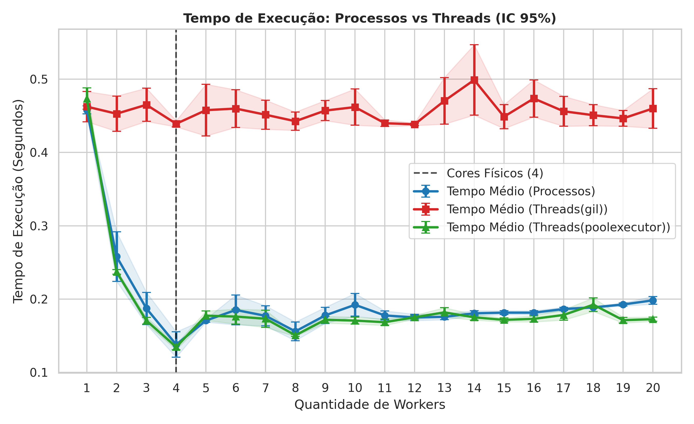
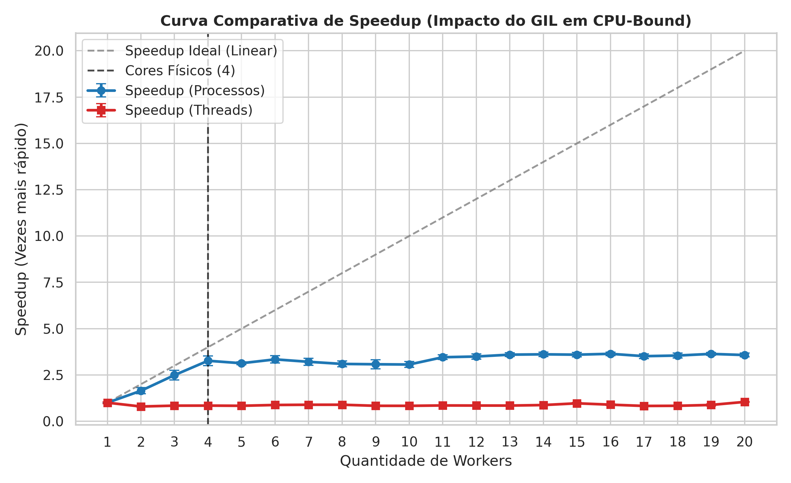
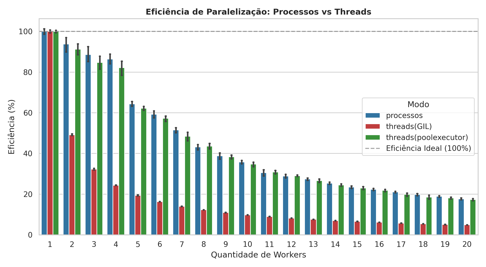

# Relatório Técnico: Avaliação de Paralelismo em Tarefas Intensivas de CPU em Python

**Disciplina:** Programação Paralela e Distribuída

---

## 1. Funcionamento do Código Avaliado

O experimento avaliou o desempenho computacional dividindo uma carga de trabalho pesada entre múltiplos *workers*. O trecho de código responsável pelo processamento é composto por duas funções encadeadas:

```python
import math


def heavy_task(n):
    """Tarefa CPU-bound que simula um processamento pesado sem usar sleep().

    Recebe o parâmetro de complexidade e executa operações matemáticas.
    """
    total = 0.0
    for i in range(1, n + 1):
        total += math.sqrt(i) * math.sin(i)
    return total


def run_chunk(args):
    """Função auxiliar para cada worker processar sua fatia."""
    (sub_n,) = args
    return heavy_task(sub_n)

```

### Explicação do Algoritmo

1. **`heavy_task(n)`:** Esta função representa a **carga de trabalho computacional pura** (*CPU-bound*).
* **Sem bloqueios artificiais:** O código evita o uso de `time.sleep()`, que apenas colocaria a *thread* em estado de espera (liberando a CPU). Em vez disso, ele mantém a CPU a 100% de uso calculando operações de ponto flutuante.
* **Custo Computacional:** A cada iteração do laço `for`, a CPU calcula a raiz quadrada (`math.sqrt(i)`) e o seno (`math.sin(i)`), acumulando o produto na variável `total`. Trata-se de uma carga determinística que exige ciclos intensivos da unidade de ponto flutuante (FPU) do processador.


2. **`run_chunk(args)`:** Atua como a **interface de mapeamento (*worker wrapper*)**.
* Quando utilizamos gerenciadores de execução paralela (`ProcessPoolExecutor` ou `ThreadPoolExecutor`), as fatias da carga de trabalho são empacotadas em tuplas de argumentos (`args`).
* A função desempacota o valor $n$ correspondente àquela fatia (`sub_n`) e invoca a execução da rotina matemática, retornando o resultado parcial para o processo principal.


---

## 2. A Problemática do *Global Interpreter Lock* (GIL) em CPython

Na linguagem Python (em sua implementação padrão CPython), a execução concorrente por meio de *threads* nativas é regida pelo **GIL (*Global Interpreter Lock*)**.

* **Para Tarefas I/O-bound (Rede/Disco):** As *threads* liberam o GIL enquanto aguardam respostas externas, permitindo alto ganho de concorrência.
* **Para Tarefas CPU-bound (`heavy_task`):** Como o laço de repetição consome ciclos ininterruptos de CPU executando *bytecodes* Python, as *threads* entram em **disputa direta (*lock contention*)** pelo GIL. Apenas **uma única *thread*** pode executar código Python por vez dentro de um mesmo processo, independentemente de quantos núcleos físicos o processador possua.

Para obter paralelismo real com tarefas *CPU-bound* em Python, utiliza-se o modelo de **múltiplos processos (`multiprocessing`)**, no qual cada *worker* roda em seu próprio processo independente, com seu próprio interpretador CPython e seu próprio GIL isolado.

---

## 3. Análise dos Resultados Empíricos

O conjunto de dados `benchmark_paralelismo.csv` registra **400 execuções** (20 configurações de quantidade de *workers* com 10 repetições cada).

### Tabela 1: Métricas de Desempenho Média por Quantidade de Workers ($p$)

| Workers ($p$) | Proc. Tempo (s) | Proc. $S_p$ | Proc. $E_p$ | Thread Tempo (s) | Thread $S_p$ | Thread $E_p$ |
| --- | --- | --- | --- | --- | --- | --- |
| **1** | 7,3314 | 1,00x | 100,0% | 7,6393 | 1,00x | 100,0% |
| **2** | 4,5424 | 1,61x | 80,7% | 9,5986 | 0,80x | 39,8% |
| **3** | 3,0129 | 2,43x | 81,1% | 9,0691 | 0,84x | 28,1% |
| **4** | 2,2735 | 3,22x | 80,6% | 9,0341 | 0,85x | 21,1% |
| **6** | 2,2082 | 3,32x | 55,3% | 8,6897 | 0,88x | 14,7% |
| **8** | 2,3788 | 3,08x | 38,5% | 8,5908 | 0,89x | 11,1% |
| **10** | 2,4047 | 3,05x | 30,5% | 9,1692 | 0,83x | 8,3% |
| **12** | 2,1046 | 3,48x | 29,0% | 8,9984 | 0,85x | 7,1% |
| **16** | 2,0155 | 3,64x | 22,7% | 8,5566 | 0,89x | 5,6% |
| **20** | 2,0537 | 3,57x | 17,8% | 7,3029 | 1,05x | 5,2% |

---

## 4. Visualização Gráfica do Desempenho

As figuras abaixo apresentam graficamente os resultados da comparação de desempenho.

### Figura 1: Comparação do Tempo de Execução entre Processos e Threads


### Figura 2: Análise de SpeedUp


### Figura 3: Eficiência da Paralelização


---

## 5. Discussão e Conclusões Técnicas

### 5.1 Desempenho com Processos (`multiprocessing`)

* **Ganho Escalar Significativo:** No intervalo de $1$ a $4$ *workers*, o tempo médio de execução cai de **7,33 segundos** para **2,27 segundos**, alcançando um **Speedup de 3,22x** e mantendo a eficiência acima de **80%**.
* **Limite do Hardware:** A partir de $4$ *workers*, o tempo se estabiliza na faixa de **2,0 s a 2,2 s**. Isso evidencia que a arquitetura do processador onde os testes foram realizados possui **4 núcleos físicos de processamento**. A adição de novos processos além dos núcleos físicos gera *overhead* de alternância de contexto no sistema operacional, estabilizando o *speedup* em aproximadamente **3,64x**.

### 5.2 Desempenho com Threads (`threading`)

* **Degradação por Contenda do GIL:** Ao aumentar de 1 para 2 *threads*, o tempo de execução **aumenta** de **7,64 s** para **9,60 s** (Speedup negativo de **0,80x**).
* **Razão do Comportamento:** Como a função `heavy_task` é estritamente matemática (*CPU-bound*), o sistema passa mais tempo alternando a posse do *lock* do GIL entre as *threads* do que efetuando processamento útil. A concorrência por *threads* sem paralelismo real gera *overhead* de sincronização, tornando a execução paralela mais lenta que a sequencial.

### 5.3 Conclusão

O experimento demonstra na prática a distinção fundamental entre **concorrência** e **paralelismo real**. Para tarefas baseadas em processamento matemático intensivo em Python, o modelo de **processos com memória separada** é indispensável para usufruir da arquitetura multicore dos computadores modernos.
